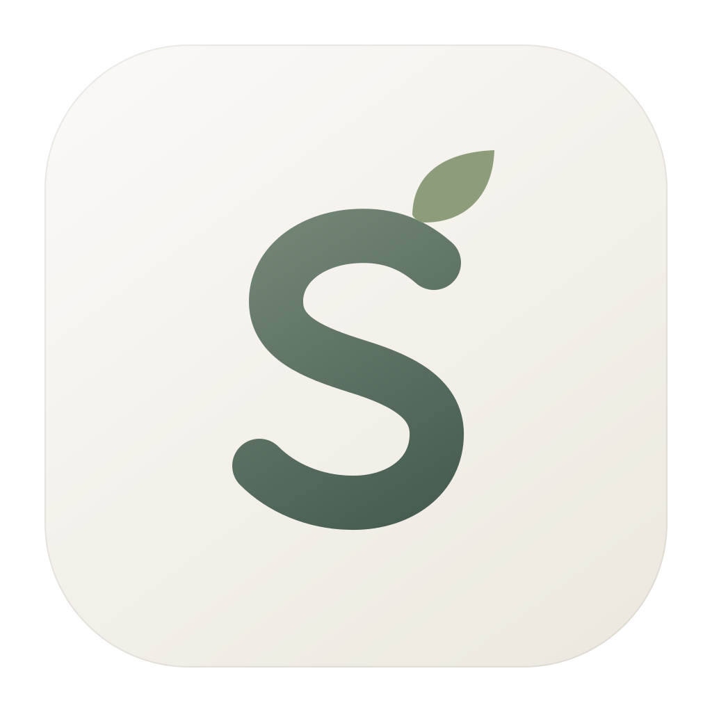

<p align="center">
  
</p>

<h1 align="center">Silens · 息壤</h1>

<div align="center">
  <strong>语言 / Language</strong>：
  <a href="README.md">简体中文</a> | <a href="README.en.md">English</a>
</div>

Silens 是一款基于 [Tauri](https://tauri.app/) 构建的本地优先 Markdown 写作工具，以温暖的纸张配色和轻柔的界面，提供打开即写的专注空间。

[产品介绍页预览入口](https://weihus.github.io/Silens/) · [下载安装包](https://github.com/weihus/Silens/releases/latest)

## 应用内更新

在“书写氛围 → 检查软件更新”中查看版本和更新说明，确认后下载安装并重启。应用启动 10 秒后及每 4 小时检查一次，在停笔、无其他弹窗且非专注模式时轻提示；不会自动下载安装。安装前必须保存笔记并创建备份，失败时保留应用和当前文字。更新包使用签名验证，检查更新不上传笔记。

较早版本需要先手动安装一次支持更新的版本。Linux 应用内更新适用于 AppImage，DEB 用户仍需下载安装包。

发布前需将与 `src-tauri/tauri.conf.json` 公钥配对的私钥配置到 GitHub Actions Secret `TAURI_SIGNING_PRIVATE_KEY`；如有密码，再设置 `TAURI_SIGNING_PRIVATE_KEY_PASSWORD`。私钥应安全备份，禁止提交仓库。发布 tag、`package.json`、`Cargo.toml` 和 Tauri 版本必须一致，例如 `v1.2.0` 对应 `1.2.0`。流水线收齐三平台签名包后生成 `latest.json` 并一起发布。

## 产品介绍页

`website/` 为独立静态站点，包含实际界面的示例笔记截图、主题预览和各平台下载入口。运行 `python3 -m http.server 4174 --directory website` 后打开 `http://localhost:4174` 预览。下载按钮从官方 GitHub Releases 获取最新安装包；接口不可用时仍可进入 Release 页下载。

GitHub 仓库的 Settings → Pages → Source 选择 **GitHub Actions** 后，推送 `website/` 改动会由 `website.yml` 部署。发布地址见该工作流的部署结果。


## v1.1.0 更新

本次次版本更新聚焦可靠保存与安静的书写体验，继续使用原有 Markdown 笔记格式。详细变更见 [更新记录](CHANGELOG.md)，操作说明见 [使用手册](MANUAL.md)。

- 修复历史笔记保存目标、清空保存和切换时的写入顺序；遇到外部修改可保留副本后重新读取。
- 快照经复制校验后发布，工作区迁移保留原文件；索引移到应用本地数据目录。
- 搜索空状态使用紧凑菜单，有结果才显示预览；修复空结果提示常驻、面板遮挡和焦点冲突。
- 暖白与灰绿色视觉层级、明确关闭的侧栏、停笔 2.2 秒后的柔和界面恢复。
- 改善中文输入法补全、Wiki 链接、Markdown 代码块空行和多格式导出；修复 Apple Silicon 上 Rosetta 开发启动的链接失败。

## 项目简介

笔记以纯文本 `.md` 文件保存，默认目录为 `Documents/Silens_Notes`。搜索与标签使用的 SQLite 索引位于应用本地数据目录，不向笔记写入私有索引元数据。日常写作不依赖云端服务，当前没有静默上传笔记的 AI 功能；用户选择的同步软件可能会同步笔记目录，`Documents` 本身也可能由 iCloud 或 OneDrive 等服务管理。

## 路线图与进度 (Roadmap & Progress)

- [x] **轻柔界面**：暖纸色、纯白和夜色主题，支持跟随系统主题及系统“减少动态效果”偏好。
- [x] **编辑与自动保存**：停止输入 1500ms 后保存到当前文件，支持清空已有笔记，并在检测到外部修改时拒绝覆盖。
- [x] **标签、时间轴与搜索**：本地索引、标签回顾、上下文搜索预览，以及明确的侧边栏、固定和搜索入口。
- [x] **专注与环境音**：打字机滚动、专注计时，以及细雨、篝火、深夜三种环境音。
- [x] **Wiki 链接**：`[[文档]]` 自动补全与正向跳转，支持前缀、子串和模糊匹配。
- [x] **快照与工作区迁移**：校验后发布备份；迁移时复制并校验笔记，保留原文件。
- [x] **反向链接 (Backlinks)**：正文下方折叠展示引用当前笔记的来源与片段，点击返回来源；专注模式隐藏。
- [ ] **AI 辅助整理**：仅为未来规划，须由用户明确选择启用后才可处理或上传笔记。

## 技术栈

前后端通过 Tauri IPC 通信：

- **前端**：React 19、TypeScript、Vite、Tailwind CSS；TipTap / ProseMirror 与 tiptap-markdown 提供编辑和 Markdown 序列化，Framer Motion 提供动画。
- **后端**：Rust 与 Tauri；`std::fs` / `walkdir` 处理文件，`serde` / `serde_json` 处理序列化，`rusqlite` 提供应用本地 SQLite 索引。

## 主要功能 (Core Features)

### 1. 书写与回顾

- **温暖的书写画布**：纸白背景、灰绿色文字与点缀、轻柔的边框和留白。界面在输入时淡出，并遵循系统减少动态效果设置。
- **明确的导航**：顶部显示当前笔记日期或文件名，浏览旧文时提供“回到今天”按钮；回顾、搜索和侧边栏固定均有明确按钮，关键控件提供可访问名称与键盘焦点提示。
- **Markdown 编辑**：导入或打开 Markdown 时保留标题和代码结构；输入 `# ` 不会自动转换为标题。支持加粗、斜体、列表和 `#标签`，通过本地索引按内容块回顾。
- **时间轴与搜索**：按日期或标签浏览；侧栏通过按钮、Escape 或未固定时点击正文收起，鼠标移出不会关闭。`Cmd/Ctrl + K` 打开紧凑搜索，有结果时展开上下文预览，窄窗口仅展示列表；固定侧栏在搜索关闭后恢复。
- **Wiki 链接与反向链接**：输入 `[[` 选择笔记，点击链接打开目标文档。有其他笔记引用当前文档时，正文下方显示折叠的“被 N 篇笔记引用”，展开查看来源和引用片段，点击返回来源并尝试定位引用。每篇来源只列一次，不含自身引用与代码示例；专注模式隐藏。引用从当前工作区文件读取，打开笔记、保存或切回应用时刷新。
- **氛围与导出**：设置面板提供主题、环境音、音量、专注时长和本地文件操作；支持导出 Markdown、纯文本、PNG 和 JPG。

### 2. 保存、备份与恢复

- **沿用当前文件名**：今天的笔记使用 `YYYY-MM-DD.md`；打开旧笔记或其他文件后，自动保存仍写回该文件。清空已有笔记也会保存，未写入内容的新页面不会创建空文件。
- **乐观冲突检查**：保存前比较磁盘内容与上次读取或保存的内容，检测到变化或删除时拒绝覆盖。写入使用临时文件后替换；失败时显示错误并保留编辑器中的文字，可先导出副本。这不等同于跨进程锁或并发修改合并。
- **关闭前保存与备份**：关闭窗口时等待待保存内容写入，再创建备份，成功后才关闭；保存或备份失败时保留窗口并提示错误。
- **本地快照**：运行期间每 6 小时、关闭窗口前，或点击“备份副本”时创建快照，位置为 `Documents/Silens_Backups`。先复制到暂存目录并校验，再发布快照；成功后清理旧快照，保留最近 10 份，清理失败时可能多于 10 份。复制或校验失败不会触发旧备份清理。
- **手动恢复**：“书写氛围 → 本地文件 → 查看备份”打开备份文件夹。恢复需手动选择并复制文件，目前没有应用内恢复界面。

### 3. 工作区与云盘

“迁移工作区”可选择本机文件夹，包括 iCloud Drive、OneDrive 或 Dropbox 的同步文件夹。Silens 将 Markdown 文件复制到目标位置的 `Silens_Notes`，校验内容并重建本地索引后切换工作区，原文件仍保留。目标已有同名且内容不同的文件时拒绝覆盖；相同内容可复用。失败时目标可能保留已经复制的文件。

跨设备同步由第三方软件负责，Silens 不保证同时编辑的冲突检测或合并。备份仍写入 `Documents/Silens_Backups`，但 `Documents` 也可能受云同步管理，因此这些快照不保证是独立的离线副本。

### 4. AI 路线图

当前标签整理和搜索在本地完成。AI 辅助整理尚未实现；未来如提供云端 AI，必须由用户明确选择启用，并说明处理范围及上传内容，不会默认在后台静默上传笔记。

## 快捷键指南 (Keyboard Shortcuts)

快捷键可与界面按钮配合使用：

- **全局搜索 (Spotlight)**：`Cmd / Ctrl` + `K`
- **呼出 / 收起时间轴**：`Cmd / Ctrl` + `L`
- **开启 / 关闭专注模式**：`Cmd / Ctrl` + `Shift` + `F`
- **打开 / 关闭氛围设置**：`Cmd / Ctrl` + `Shift` + `M`
- **撤销**：`Cmd / Ctrl` + `Z`
- **重做**：`Cmd / Ctrl` + `Y` 或 `Shift` + `Cmd / Ctrl` + `Z`

## 💻 开发与构建

### 环境准备

在开始之前，请确保您的开发环境已安装以下依赖：
- Node.js (推荐 LTS 版本)
- Rust (通过 `rustup` 安装)
- Tauri 开发环境依赖 (视您的操作系统而定：Windows 需 C++ Build Tools，macOS 需 Xcode，Linux 需 webkit2gtk 等)

### 安装依赖

克隆项目到本地后，在项目根目录下安装前端依赖：

```bash
npm install
```

### 本地开发 (Development)

你可以选择仅启动前端环境，或启动完整的 Tauri 桌面端环境：

**仅启动前端 (Web 模式)**:
```bash
npm run dev
```

**启动完整桌面端 (Tauri 模式)**:

```bash
npx tauri dev
```
*首次运行由于需要编译 Rust 依赖，可能会花费一些时间，请耐心等待。后续编译会利用缓存，速度大幅提升。*

macOS 使用 `tauri.macos.conf.json` 配置的原生 Cargo 启动器；在 Apple Silicon 的 Rosetta 终端中会以 arm64 启动 Cargo，避免 `cc/xcrun` 架构不匹配。仅启动前端时不提供原生文件接口，完整笔记操作请使用 Tauri 模式。

验证命令：`npm run build`、`npx vitest run`、`cargo test --manifest-path src-tauri/Cargo.toml`。Rosetta 终端可使用 `scripts/cargo-native.sh test --manifest-path src-tauri/Cargo.toml`。

### 打包构建 (Build)

当您准备发布应用时，运行以下命令。Tauri 会自动构建前端产物，并将其与 Rust 后端编译为各平台原生的可执行文件（如 `.exe`, `.app`, `.dmg`, `.deb`）：

```bash
npx tauri build
```
构建产物将输出在 `src-tauri/target/release/bundle/` 目录下。

## 📁 核心目录结构

```text
Sliens/
├── src/                    # 前端源代码 (UI, API 封装, 路由, 状态管理)
├── src-tauri/              # Rust 后端源代码
│   ├── Cargo.toml          # Rust 依赖及项目配置
│   ├── tauri.conf.json     # Tauri 核心配置文件 (窗口属性, 权限, 构建设置)
│   └── src/
│       └── main.rs         # 核心 Rust 逻辑 (文件 I/O, 标签替换, IPC 指令注册)
├── package.json            # 前端依赖与脚本配置
└── README.md               # 项目说明文档
```

## 🤝 贡献指南

欢迎提交 Issue 或 Pull Request 来完善此项目！如果您有任何针对 Markdown 渲染或者本地文件管理机制的优化建议，请随时发起讨论。

## 📄 开源协议

MIT License